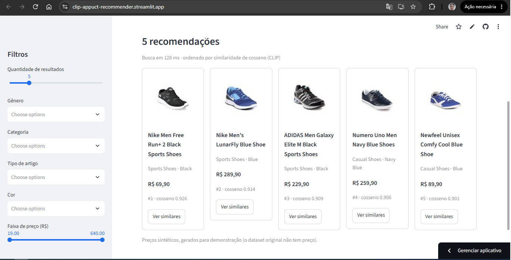

# Recomendador Multimodal de Produtos

**Demo:** [clip-pro-recommender.streamlit.app](https://clip-pro-recommender.streamlit.app/) ·

Sistema de recomendação de produtos por **imagem**, **texto** ou **os dois juntos**. Os embeddings vêm do CLIP (Hugging Face), a busca por similaridade de cosseno roda no ChromaDB e a interface é um app Streamlit.



*Busca por imagem no app: cinco tênis esportivos e casuais, ordenados por similaridade de cosseno (CLIP). Os preços são sintéticos (veja as limitações).*

```
catálogo (CSV + imagens)
   │  scripts/prepare_data.py        limpeza, imagens padronizadas por ID
   ▼
data/processed/catalog.parquet + images/{id}.jpg
   │  scripts/generate_embeddings.py CLIP em mini-batches, memmap, retomável
   ▼
data/processed/embeddings/*.npy
   │  scripts/build_index.py         ChromaDB (HNSW, cosseno) + metadados
   ▼
data/vectorstore/                    products_image / products_text
   │  src/recommender/search.py      texto, imagem e busca combinada
   ▼
app.py (Streamlit)  ·  scripts/search_demo.py (CLI)
```

## Como rodar

```bash
python -m venv .venv && source .venv/bin/activate      # Windows: .venv\Scripts\activate
pip install -r requirements-dev.txt                    # app + pipeline + testes (requirements.txt = só o app)
cp .env.example .env                                   # preencha KAGGLE_USERNAME e KAGGLE_KEY

python scripts/prepare_data.py                         # Passo 1: baixa e limpa o dataset
python scripts/generate_embeddings.py                  # Passo 2: embeddings (CLIP)
python scripts/build_index.py                          # Passo 3: índice no ChromaDB
python -m streamlit run app.py                         # Passo 5: interface
```

Para testar rápido, use `--limit 2000` no Passo 1 e rode o Passo 2 sem `--limit`. Todos os scripts são idempotentes e têm `--help`.

Busca pela linha de comando:

```bash
python scripts/search_demo.py --text "black running shoes"
python scripts/search_demo.py --image data/processed/images/1530.jpg --exclude-id 1530 --grid resultado.jpg
python scripts/search_demo.py --image foto.jpg --text "in black" --gender Men --max-price 200
```

## Avaliação

```bash
python scripts/evaluate.py             # imagem→imagem, texto→imagem e texto→descrição
python scripts/evaluate.py --skip-text # só imagem→imagem (não carrega o CLIP)
```

A relevância vem dos metadados do catálogo: dois produtos são relevantes entre si se tiverem o mesmo tipo de artigo (critério estrito: mesmo tipo **e** mesma cor). O relatório traz P@1/5/10, MRR e HitRate, cada um com intervalo de confiança de 95% e a **precisão esperada de um ranking aleatório**, que mostra o ganho real do modelo sobre o acaso. Os resultados são salvos em `reports/eval_<modelo>.json` e `.md` (a tabela pode ser colada aqui). Para comparar modelos sem tocar no índice do deploy, aponte `MMREC_CLIP_MODEL_NAME`, `MMREC_EMBEDDINGS_DIR_NAME` e `MMREC_VECTORSTORE_DIR` para pastas separadas (veja o `.env.example`), gere embeddings, índice e avaliação, e rode `python scripts/compare_reports.py`.

Limitação: é um proxy. Itens de tipos diferentes podem ser substitutos razoáveis, e quase-duplicatas do catálogo inflam a precisão imagem→imagem; os números medem coerência com o catálogo, não satisfação de usuários.

### Resultados (CLIP ViT-B/32, 1.999 produtos)

#### imagem → imagem (500 consultas)

| Métrica | Resultado (IC 95%) | Acaso | Ganho |
|---|---|---|---|
| P@1 (tipo) | 0.748 ± 0.038 | 0.055 | 13.6× |
| P@5 (tipo) | 0.706 ± 0.030 | 0.055 | 12.8× |
| P@10 (tipo) | 0.682 ± 0.029 | 0.055 | 12.4× |
| MRR (tipo) | 0.819 ± 0.029 | - | - |
| P@5 (categoria) | 0.981 ± 0.009 | 0.340 | 2.9× |
| P@5 (tipo+cor) | 0.232 ± 0.023 | 0.008 | 30.9× |

#### texto → imagem (96 consultas)

| Métrica | Resultado (IC 95%) | Acaso | Ganho |
|---|---|---|---|
| P@5 (tipo) | 0.665 ± 0.070 | 0.050 | 13.3× |
| P@10 (tipo) | 0.635 ± 0.064 | 0.050 | 12.7× |
| P@5 (tipo+cor) | 0.462 ± 0.066 | 0.007 | 67.9× |
| P@10 (tipo+cor) | 0.400 ± 0.051 | 0.007 | 58.7× |
| MRR (tipo+cor) | 0.631 ± 0.079 | - | - |
| HitRate@10 (tipo+cor) | 0.896 ± 0.061 | - | - |

#### texto → descrição (96 consultas)

| Métrica | Resultado (IC 95%) | Acaso | Ganho |
|---|---|---|---|
| P@5 (tipo) | 0.648 ± 0.060 | 0.050 | 13.0× |
| P@10 (tipo) | 0.575 ± 0.051 | 0.050 | 11.5× |
| P@5 (tipo+cor) | 0.537 ± 0.059 | 0.007 | 78.9× |
| P@10 (tipo+cor) | 0.426 ± 0.046 | 0.007 | 62.5× |
| MRR (tipo+cor) | 0.754 ± 0.069 | - | - |
| HitRate@10 (tipo+cor) | 0.969 ± 0.035 | - | - |

Leitura dos números:

- **Imagem → imagem:** o vizinho nº 1 tem o mesmo tipo de artigo em 3 de cada 4 consultas (P@1 = 0.748), e 98% dos 5 primeiros resultados são da mesma categoria. A cor é mais difícil (P@5 tipo+cor = 0.232): o embedding visual agrupa por forma e tipo antes de agrupar por cor.
- **Texto → imagem funciona sem treinamento:** com um prompt curto, em cerca de 90% das consultas há um produto do mesmo tipo e cor entre os 10 primeiros (HitRate@10 = 0.896).
- **Texto → descrição não é comparável de forma direta:** as descrições indexadas são geradas a partir dos mesmos metadados que definem a relevância, então essa linha mede a coerência do encoder de texto com os rótulos, não a compreensão visual. Os intervalos de confiança também se sobrepõem em parte (por exemplo, MRR 0.754 ± 0.069 contra 0.631 ± 0.079). Por isso o app usa texto → imagem como padrão.
- **Ganho sobre o acaso:** quando a precisão esperada ao acaso é minúscula (0.007 a 0.008 no critério tipo+cor), o ganho em múltiplos fica enorme; prefira citar o valor absoluto junto com ele.

### Comparação de modelos: ViT-B/32 contra ViT-L/14

Mesmo catálogo (1.999 produtos), mesmas consultas e mesma semente; só muda o modelo. Valores: média ± IC 95%.

| Experimento | Métrica | ViT-B/32 (512-d) | ViT-L/14 (768-d) |
|---|---|---|---|
| imagem → imagem | P@1 (tipo) | 0.748 ± 0.038 | 0.778 ± 0.036 |
| | P@5 (tipo) | 0.706 ± 0.030 | 0.736 ± 0.028 |
| | P@10 (tipo) | 0.682 ± 0.029 | 0.694 ± 0.028 |
| | MRR (tipo) | 0.819 ± 0.029 | 0.844 ± 0.027 |
| | P@5 (categoria) | 0.981 ± 0.009 | 0.982 ± 0.009 |
| | P@5 (tipo+cor) | 0.232 ± 0.023 | 0.208 ± 0.021 |
| texto → imagem | P@5 (tipo) | 0.665 ± 0.070 | 0.702 ± 0.063 |
| | P@10 (tipo) | 0.635 ± 0.064 | 0.686 ± 0.058 |
| | P@5 (tipo+cor) | 0.462 ± 0.066 | 0.435 ± 0.063 |
| | P@10 (tipo+cor) | 0.400 ± 0.051 | 0.406 ± 0.051 |
| | MRR (tipo+cor) | 0.631 ± 0.079 | 0.659 ± 0.076 |
| | HitRate@10 (tipo+cor) | 0.896 ± 0.061 | 0.917 ± 0.056 |
| texto → descrição | P@5 (tipo) | 0.648 ± 0.060 | 0.752 ± 0.060 |
| | P@10 (tipo) | 0.575 ± 0.051 | 0.667 ± 0.055 |
| | P@5 (tipo+cor) | 0.537 ± 0.059 | 0.654 ± 0.060 |
| | P@10 (tipo+cor) | 0.426 ± 0.046 | 0.520 ± 0.052 |
| | MRR (tipo+cor) | 0.754 ± 0.069 | 0.872 ± 0.058 |
| | HitRate@10 (tipo+cor) | 0.969 ± 0.035 | 0.958 ± 0.040 |

**Conclusão: o modelo grande não mostrou ganho comprovado, e o app usa o ViT-B/32.**

- Em nenhuma métrica os intervalos de confiança de 95% dos dois modelos deixam de se sobrepor. O critério é conservador (as consultas são as mesmas nos dois modelos, e um teste pareado poderia detectar diferenças menores), então o resultado correto é "sem evidência de diferença", e não "iguais".
- O ViT-L/14 é numericamente melhor na maioria das métricas por tipo (por exemplo, P@10 texto → imagem 0.686 contra 0.635), mas o ViT-B/32 é melhor na cor: P@5 tipo+cor imagem → imagem 0.232 contra 0.208, e texto → imagem 0.462 contra 0.435.
- As maiores diferenças aparecem em texto → descrição (MRR 0.872 contra 0.754), que é justamente o experimento em que a relevância e o texto indexado vêm dos mesmos metadados; não use essa linha como evidência de melhor compreensão.
- Custo: o ViT-L/14 tem cerca de 1,7 GB de pesos contra ~600 MB do ViT-B/32, vetores 50% maiores e levou 1h14 em CPU só para gerar os embeddings das 1.999 imagens. Com um limite de memória de poucos GB no Streamlit Community Cloud, o ganho não comprovado não compensa o risco de o app reiniciar.

## Decisões de projeto

| Decisão | Por quê |
|---|---|
| CLIP ViT-B/32 no deploy | A comparação com o ViT-L/14 não mostrou ganho estatisticamente separável, e o B/32 é mais leve em memória e em tempo de indexação. |
| Vetores normalizados em L2 + índice HNSW em `cosine` | O cosseno vira produto interno e o banco não recalcula normas na consulta. |
| Duas coleções (`products_image`, `products_text`) | Texto→imagem é o uso zero-shot do CLIP; texto→descrição acerta mais em marca e nome exato. |
| Memmap `.npy` + checkpoints | RAM constante independentemente do tamanho do catálogo; uma execução interrompida retoma do último checkpoint. |
| Fingerprint (catálogo, modelo, dimensão) no índice | Impede misturar vetores de modelos diferentes sem aviso. |
| Modelo de consulta lido dos metadados da coleção | A consulta sempre usa o mesmo CLIP que indexou, independentemente do `.env`. |
| Filtros derivados do índice, não do catálogo | As opções mostradas existem de fato na busca, e o deploy dispensa o `catalog.parquet`. |
| Busca combinada = média ponderada normalizada de imagem e texto | Heurística simples do CLIP para refinar ("esta jaqueta, mas em preto"). |

## Limitações conhecidas

- **Preços sintéticos.** O dataset do Kaggle não tem preço; a coluna `price` é gerada de forma reprodutível e marcada com `price_is_synthetic=True`.
- **Texto em inglês.** O CLIP original foi treinado majoritariamente em inglês; consultas em português rendem menos.
- **Scores de texto→imagem são baixos por natureza** (em torno de 0.2 a 0.35 mesmo para bons resultados) e não são comparáveis com os de imagem→imagem.
- O dataset *small* tem imagens de baixa resolução; o dataset completo (`MMREC_KAGGLE_DATASET=paramaggarwal/fashion-product-images-dataset`) dá resultados visualmente melhores, ao custo de ~15 GB.

## Testes

```bash
python -m pytest -q
```

Os testes usam um backend de embeddings falso e o ChromaDB real, então rodam sem GPU e sem baixar o CLIP. Eles cobrem batching, persistência e retomada, indexação, busca, filtros e o app (via `streamlit.testing`).

## Deploy (Streamlit Community Cloud)

O app só consulta o índice, então o repositório precisa conter o código, `data/vectorstore/` e `data/processed/images/`. O `.gitignore` já está ajustado para isso (embeddings brutos, catálogo e dataset bruto continuam de fora).

1. Gere o índice com um subconjunto que caiba no GitHub (arquivos de até 100 MB): alguns milhares de produtos bastam para a demonstração.
2. Rode `python scripts/check_deploy.py`. Ele confirma que o índice abre, que toda imagem existe com caminho relativo e que nenhum arquivo passa do limite.
3. Fixe no `requirements.txt` as versões que você usou localmente (`pip freeze | findstr /i "chromadb torch transformers streamlit"`), principalmente o `chromadb`: o índice é gravado por uma versão e deve ser lido pela mesma.
4. `git add -A && git commit && git push`. O Streamlit Cloud redeploya sozinho.

Pontos de atenção:

- O primeiro start baixa o CLIP (~600 MB) e o carrega junto com o PyTorch. A documentação do Streamlit lista, "aproximadamente" e sujeito a mudança, 690 MB de memória mínima e 2,7 GB no máximo por app; a faixa esperada deste app é de 1 a 1,5 GB (estimativa, não medida). Se o app reiniciar por falta de memória, hospede em um serviço com mais RAM (por exemplo, Hugging Face Spaces).
- A linha `--extra-index-url` do `requirements.txt` instala o PyTorch em CPU. Se o build falhar por causa dela, apague-a.
- Exemplo de `Dockerfile` para outros hosts (não testado neste repositório):

```dockerfile
FROM python:3.11-slim
WORKDIR /app
COPY requirements.txt .
RUN pip install --no-cache-dir -r requirements.txt
COPY . .
EXPOSE 7860
CMD ["python", "-m", "streamlit", "run", "app.py", "--server.port=7860", "--server.address=0.0.0.0"]
```
